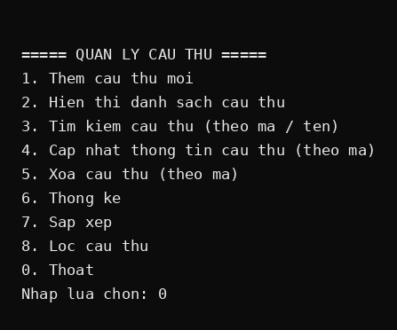
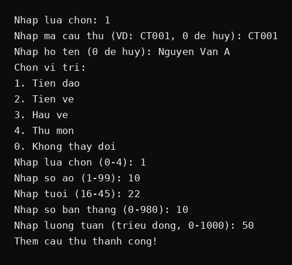
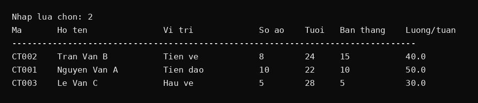
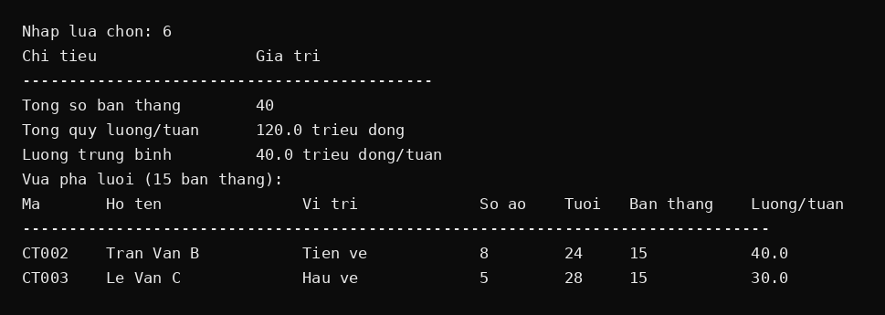

# QUẢN LÝ CẦU THỦ BÓNG ĐÁ

Dự án cuối khóa môn Lập trình C/C++ — ứng dụng console quản lý danh sách cầu thủ của một đội bóng.

## Giới thiệu

Chương trình cho phép quản lý thông tin cầu thủ (mã, họ tên, vị trí, số áo, tuổi, số bàn thắng, lương tuần).
Dữ liệu lưu trong `struct` kết hợp mảng một chiều tĩnh (tối đa 100 cầu thủ) và được ghi ra file
`cauthu.txt` sau mỗi lần thêm/sửa/xóa; khi khởi động, chương trình đọc lại file này nên dữ liệu
không bị mất khi thoát. Người dùng thao tác qua menu điều khiển lặp (do-while + switch-case)
với đầy đủ chức năng CRUD, tìm kiếm, thống kê, sắp xếp và lọc.

**Công nghệ:** Mã nguồn viết bằng C, lưu dưới đuôi `.cpp` và biên dịch bằng `g++`.
Giao diện dòng lệnh (Console). Không dùng cơ sở dữ liệu, giao diện đồ họa hay thư viện nâng cao.

## Tính năng

1. Thêm cầu thủ mới (kiểm tra mã trùng, validate dữ liệu nhập)
2. Hiển thị danh sách cầu thủ dạng bảng
3. Tìm kiếm cầu thủ theo mã (chính xác) hoặc theo tên (tìm gần đúng, không phân biệt hoa thường)
4. Cập nhật thông tin cầu thủ theo mã
5. Xóa cầu thủ theo mã
6. Thống kê: tổng số bàn thắng, tổng quỹ lương/tuần, lương trung bình, vua phá lưới
7. Sắp xếp cầu thủ theo số bàn thắng giảm dần (đồng bàn thắng thì theo mã tăng dần)
8. Lọc cầu thủ theo vị trí (Tiền đạo / Tiền vệ / Hậu vệ / Thủ môn)

## Cấu trúc thư mục

```
.
├── main.cpp            # mã nguồn chính (viết bằng C, đuôi .cpp)
├── cauthu.txt          # dữ liệu cầu thủ (tự tạo khi chạy, định dạng ma|ten|viTri|soAo|tuoi|banThang|luong)
├── README.md           # tài liệu dự án
├── .gitignore          # loại trừ file biên dịch
└── screenshots/        # ảnh chụp màn hình demo
```

## Thành viên & phân công

| Họ tên                 | Vai trò     | Công việc phụ trách                                                                                                                          |
| ---------------------- | ----------- | -------------------------------------------------------------------------------------------------------------------------------------------- |
| Nguyễn Trần Minh Quân  | Trưởng nhóm | Tạo repo, thiết kế struct `CauThu` + menu, chức năng Thêm mới, kiểm tra mã trùng, validate nhập liệu, hợp nhất code 3 nhánh, báo cáo tiến độ |
| Trương Phạm Hoàng Long | Thành viên  | Chức năng Tìm kiếm (theo mã/tên), Cập nhật, Xóa; test chéo code của nhóm                                                                     |
| Nguyễn Hoàng Minh      | Thành viên  | Chức năng Hiển thị dạng bảng, Thống kê, Sắp xếp/Lọc, hoàn thiện README, board theo dõi                                                       |

## Cách biên dịch và chạy

Yêu cầu: trình biên dịch G++ (MinGW trên Windows, hoặc g++ có sẵn trên Linux/macOS).
Vì mã nguồn dùng đuôi `.cpp` nên biên dịch bằng `g++`:

```bash
# Biên dịch
g++ main.cpp -o quanlycauthu

# Chạy chương trình
# Windows:
quanlycauthu.exe
# Linux / macOS:
./quanlycauthu
```

## Ảnh chụp màn hình demo






## Tiến độ thực hiện

- [x] Tuần 1: Chốt đề tài, tạo repo, thiết kế struct, menu, Thêm mới, Hiển thị
- [x] Tuần 2: Tìm kiếm, Cập nhật, Xóa, Thống kê, Sắp xếp/Lọc
- [x] Tuần 3: Test toàn bộ, sửa lỗi, hoàn thiện README, chuẩn bị demo và vấn đáp
